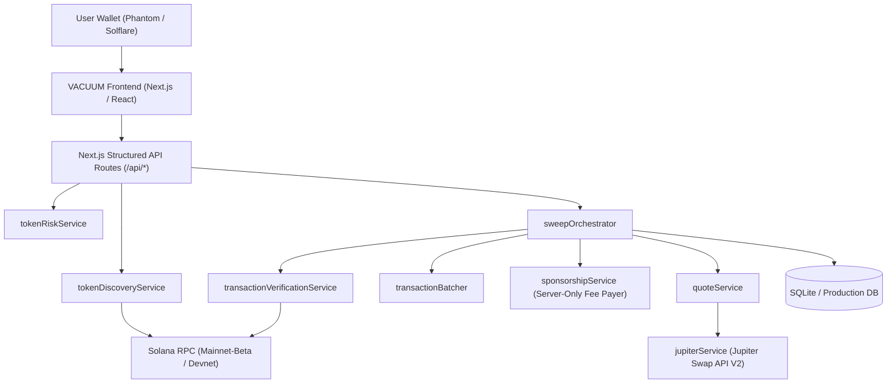

# VACUUM Technical Architecture

## 1. High-Level System Overview

VACUUM is engineered with strict separation between the presentation layer (Next.js App Router + React 19 + Tailwind CSS), the domain orchestration layer (`src/services/*`), and the persistence layer (`src/lib/db.ts` backed by SQLite WAL in local/edge environments and compatible with PostgreSQL in distributed deployments).

---

## 2. Service Modules (`src/services/`)

| Module | Responsibility |
| :--- | :--- |
| `walletService.ts` | Validates base58 public keys, formats display addresses, and manages multi-wallet connection records without storing private keys. |
| `tokenDiscoveryService.ts` | Queries `TOKEN_PROGRAM_ID` and `TOKEN_2022_PROGRAM_ID` accounts via Solana RPC, parses balances, inspects mint/freeze authorities, and calculates reclaimable rent (`2,039,280 lamports` per standard token account). |
| `tokenRiskService.ts` | Evaluates 6 security signals: phishing URLs in metadata, active freeze authority, active mint authority, Token-2022 transfer hooks/fees, price impact, and liquidity depth. |
| `pricingService.ts` | Normalizes raw token balances across decimals (`0–18`) and retrieves USD prices from Jupiter Price API V2 (`https://api.jup.ag/price/v2`). |
| `liquidityService.ts` | Classifies assets into 7 canonical categories (`VALUABLE_ESTABLISHED`, `SMALL_BALANCE`, `POTENTIAL_DUST`, `INSUFFICIENT_LIQUIDITY`, `NO_VIABLE_ROUTE`, `SUSPICIOUS_UNSUPPORTED`, `REQUIRES_INSPECTION`) and separates **Potential Dust** from **Recoverable Dust**. |
| `jupiterService.ts` | Integrates Jupiter Swap API V2 (`GET /swap/v2/order` and `POST /swap/v2/execute`) with support for `taker`, `payer` (gasless integrator sponsor), `x-api-key`, and quote freshness validation. |
| `quoteService.ts` | Orchestrates executable quotes across selected dust tokens and isolates unroutable tokens so they do not block viable swaps. |
| `transactionBatcher.ts` | Groups instructions into `VersionedTransaction` (v0) batches respecting Solana's `1,232-byte` packet limit, `64-account` cap, and `1,400,000 CU` ceiling. |
| `sponsorshipService.ts` | Evaluates sweep economic viability, enforces per-wallet and daily sponsorship budgets, applies hourly anti-Sybil rate limits, and co-signs `VersionedTransaction` payloads server-side as designated fee payer. |
| `transactionVerificationService.ts` | Simulates transactions (`simulateTransaction`) and polls on-chain signature finality (`getSignatureStatuses`, `getTransaction`) before marking any batch `CONFIRMED`. |
| `sweepOrchestrator.ts` | Coordinates the 11-step sweep lifecycle, batch status transitions (`COMPLETED`, `PARTIAL_SUCCESS`, `FAILED`), and database persistence. |
| `historyService.ts` | Retrieves wallet sweep history and generates SHA-256 verifiable exportable `SweepReceipt` documents. |
| `analyticsService.ts` | Aggregates real historical metrics (`totalValueSweptUsd`, `totalVacuumAcquiredUi`, `totalFeesSponsoredLamports`). |
| `vacuumTokenService.ts` | Manages `$VACUUM`, `SOL`, and `USDC` destination configurations and planned `$VACUUM` utility feature flags without hardcoding unverified mint addresses. |

---

## 3. Why No Custom On-Chain Anchor Program Is Required for MVP

Per the architecture directive, VACUUM avoids unnecessary custom smart contracts:
- Solana natively supports multi-instruction atomic composition (`VersionedTransaction` v0) and native designated fee payers (`payerKey` at account index 0).
- Jupiter Swap API V2 natively supports integrator `payer` sponsorship and meta-aggregated swap execution.
- Native SPL Token `BurnChecked` and `CloseAccount` instructions reclaim rent directly to the user's wallet without intermediate custody contracts.

---

## 4. Database Schema (`src/lib/db.ts`)

13 normalized tables with foreign keys and composite indexes:
1. `users`
2. `connected_wallets`
3. `token_metadata_cache`
4. `risk_assessments`
5. `discovered_assets`
6. `sweep_sessions`
7. `transaction_batches`
8. `sweep_items`
9. `transaction_records`
10. `sponsorship_records`
11. `application_configuration`
12. `feature_flags`
13. `analytics_events`
